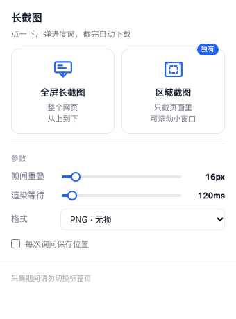
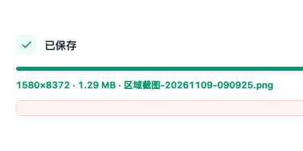
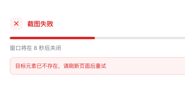
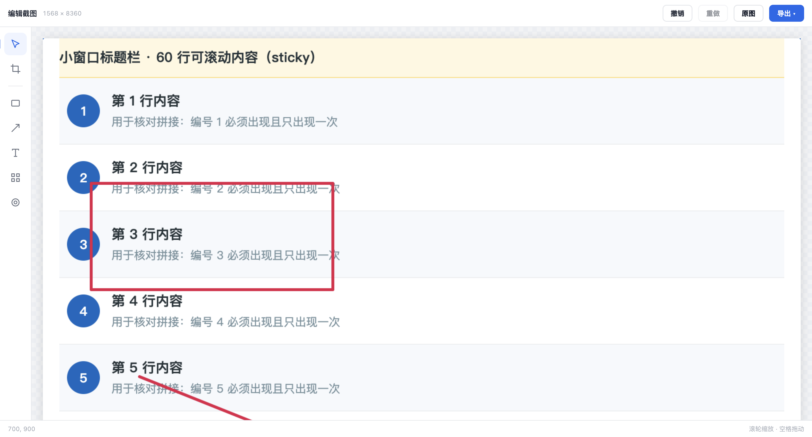

# 长截图 · 全屏 / 区域二合一

一个 Chrome 扩展（Manifest V3）：**点一下图标，选择「全屏长截图」或「区域截图」**，
逐帧滚动拼接成一张完整长图，自动下载到「下载」文件夹。

> 区域截图专门解决一个常见痛点：整个网页很长，但你只想截**其中那个可滚动的小窗口**
> （聊天记录、代码面板、文档预览、表格……），不要页头、侧栏和大页面背景。

---

## 界面

| 选择窗口 | 截图中 | 完成 |
|---|---|---|
|  |  |  |

编辑器：



---

## 特性

| 特性 | 说明 |
|---|---|
| **两种模式** | 全屏长截图（整个网页）/ 区域截图（只截你点中的可滚动小窗口） |
| **可指定范围** | **两种模式都支持**「全部 / 从当前可见处 / 自定义 from~to」，不必每次都从头截 |
| **自动复制** | 可选：截完自动把图片放进剪贴板，直接粘到聊天框/文档里 |
| **无边框接缝** | 自动排除容器 `border`，四边各内缩 1 CSS 像素，拼接处不留蓝边/横线 |
| **重复元素只出现一次** | `position: sticky` / `fixed` 元素（如黄色标题栏、顶部导航）只在长图顶部出现一次，不再每帧重复 |
| **秒级出图** | 采集逻辑跑在独立扩展页而非 service worker，截图撞配额只 `sleep(50)` 重试；10 帧约 4~5 秒 |
| **内置编辑器** | 截完直接进编辑器：裁剪、矩形框、箭头、文字、马赛克、模糊，可撤销重做 |
| **悬浮说明** | 鼠标停在工具上稍候，会弹出该工具的用法与快捷键 |
| **格式可选** | PNG（无损）或 JPG（质量 92%，体积小） |
| **实时进度** | 独立进度小窗显示「第 N/M 帧 → 正在导出 → ✅ 已保存」，不污染截图内容 |
| **零依赖** | 纯原生 JS + Canvas，无任何第三方库 |

---

## 安装（开发者模式）

本扩展未上架 Chrome Web Store，以「加载已解压的扩展程序」方式安装：

1. 下载或克隆本仓库到本地。
2. 打开 `chrome://extensions/`，右上角开启 **开发者模式**。
3. 点 **加载已解压的扩展程序**，选择本仓库的 `extension/` 目录。
4. 工具栏出现蓝色方框图标，固定到工具栏即可使用。

> Chrome 156+ 起 `--load-extension` 命令行侧载被禁用，必须走上面的 GUI 路径。

---

## 使用

### 全屏长截图

1. 打开要截的网页。
2. 点扩展图标 → 点 **🖥️ 全屏长截图**。
3. 弹出进度小窗，几秒后自动打开**编辑器**（可在 popup 里关掉「截完先编辑」直接下载）。
4. 在编辑器里裁剪 / 标注，点「导出」→ 下载。

### 区域截图

1. 打开包含可滚动小窗口的网页。
2. 点扩展图标 → 点 **🔲 区域截图**。
3. 鼠标在页面上移动，可滚动区域会蓝色高亮并显示尺寸（`可滚 XXXXpx`）。
4. **点一下**那个小窗口即开始采集，随后自动打开编辑器。
5. 按 `Esc` 取消框选。

### 参数

popup 里可调：

- **帧间重叠**：默认 16px。调小可减少帧数但可能出现接缝，调大可提高容错。
- **渲染等待**：默认 120ms。页面有懒加载/动画时可调大。
- **格式**：PNG（无损）/ JPG（质量 92%）。
- **每次询问保存位置**：勾选后每次弹保存对话框。
- **截完自动复制到剪贴板**：勾选后图片直接进剪贴板（编辑器打开后复制，或直接下载时复制）。
- **截取范围**（**全屏与区域模式都支持**）：`全部` / `从当前可见处`（从你当前滚动到的地方开始，直到末尾）/ `自定义`（填起始与结束像素，可点「取当前」自动填入当前滚动位置）。
  区域模式下范围作用于**小窗口内部的滚动偏移**，不是页面坐标。

---

## 实现要点

### 为什么采集跑在扩展页而不是 service worker

MV3 service worker 会被回收、调度粒度粗，`chrome.tabs.captureVisibleTab` 在里面只能整秒等配额。
本扩展照搬 [GoFullPage](https://github.com/MrRio/GoFullPage) 的架构：
点图标后用 `chrome.windows.create({type:'popup'})` 打开 `capture.html` 这个**独立扩展页**，
滚动 / 截图 / 拼接 / 导出全在页面里完成：

```js
// 撞配额只等 50ms 就重试，没有「帧间隔」概念
for (;;) {
  try { return await chrome.tabs.captureVisibleTab(windowId, { format: 'png' }); }
  catch (e) {
    if (/MAX_CAPTURE_VISIBLE_TAB_CALLS_PER_SECOND/.test(e.message)) { await sleep(50); continue; }
    throw e;
  }
}
```

必须开成**独立窗口**：`captureVisibleTab` 截的是目标标签所在窗口的 active 标签，
若把采集页开成同窗口的普通标签，它会自己变成 active，截到的就是它自己（全白）。

### 无边框接缝

`getBoundingClientRect()` 返回**含 border 的外框**，而 `scrollTop` 只滚动**内容区**。
所以裁剪时用内容区矩形，并四边再内缩 1 CSS 像素兜底：

```js
const bl = el.clientLeft, bt = el.clientTop;
rect = { left: r.left + bl, top: r.top + bt,
         width: el.clientWidth, height: el.clientHeight };
// 拼接时 ins = Math.round(1 * scale)，四边各减 ins
```

### 重复元素只出现一次

首帧记录容器内所有 `position: sticky | fixed` 的元素，第 2 帧起统一 `visibility: hidden`：

```js
function collectPinned(scope) { /* 首帧：记录所有 sticky/fixed 元素 */ }
function hidePinnedAfterFirst() { /* 第 2 帧起：visibility: hidden */ }
function restorePinned() { /* 采集结束：逐条还原（含移除临时 style 属性） */ }
```

> 试过 GoFullPage 的另一条路（改成 `position: absolute` 并重算 `left/top`），
> 但元素脱流后容器 `scrollHeight` 变化、内容整体上移，会导致 `scrollTop` 越界、第 2 帧滚动失败。
> `visibility: hidden` 不脱流、不改布局，更稳。

### 导出

```js
const blob = await new Promise(res => canvas.toBlob(res, mime, jpeg ? 0.92 : undefined));
const url = URL.createObjectURL(blob);
await chrome.downloads.download({ url, filename, conflictAction: 'uniquify', saveAs });
```

不用 `btoa` 逐字节拼 dataURL（大图要遍历上百万字节，慢且内存翻倍）。

---

## 目录结构

```
.
├── extension/            ← Chrome 加载这个目录
│   ├── manifest.json     MV3 清单
│   ├── background.js     service worker：只做消息路由 + 开采集窗口
│   ├── content.js        框选器 + 滚动执行 + sticky 处理 + 页面恢复
│   ├── capture.html/js   采集工作页：滚动 / 截图 / 拼接
│   ├── editor.html/js    编辑器：裁剪 + 标注 + 导出
│   ├── store.js          IndexedDB 图片暂存（采集页→编辑器交接）
│   ├── popup.html/js     「全屏 / 区域」选择窗口 + 参数
│   └── icon.png
├── test-page.html        ← 验收页①：大页面里嵌一个 60 行可滚动小窗口
├── test-long.html        ← 验收页②：50 段的长页面（测范围截取）
└── README.md
```

### 验收页

`test-page.html` 是自带的测试页面：左侧固定栏 + 右侧一个带蓝色边框、60 行编号内容的可滚动小窗口，
用来验证「只截小窗口、不含页头侧栏」「编号 1→60 连续无重复」「无边框接缝」「sticky 标题栏只出现一次」。

启动本地服务后打开：

```bash
cd area-scroll-capture && python3 -m http.server 8765
# 浏览器访问 http://127.0.0.1:8765/test-page.html
```

---

## 已知限制

- **不能截 Chrome 内置页面**（`chrome://`、Web Store 等），Chrome 不允许扩展截图。
- **锁屏时截图会失败**：macOS 锁屏状态下 GPU 不允许读回窗口像素，
  `captureVisibleTab` 会报 `image readback failed`，解锁后重试即可。
- **采集期间请勿切换标签页**：`captureVisibleTab` 截的是当前 active 标签。
- 长图上限约 16384px（Chrome Canvas 限制），超长页面需分段截。

---

## 更新日志

### v2.8.0
- **区域截图也支持截取范围**：整个小窗口 / 从当前可见处 / 自定义（坐标是小窗口内部偏移）
- popup 范围文案随全屏/区域模式自动切换（悬停或聚焦卡片即切换）
- 修复区域模式设置丢失：框选前先 `ASC_SAVE_OPTIONS` 存一份，框选完成后合并使用
- `pickRange` 增加 DOM 属性兜底（页面存在多份 content 实例时局部变量不共享）

### v2.7.0
- **从指定位置开始截**：全屏模式新增「整页 / 从当前可见处 / 自定义 from~to」三种范围
- **自动复制到剪贴板**：新增开关，截完直接进剪贴板
- 修复关键缺陷：`captureVisibleTab` 对**非前台窗口**返回陈旧合成帧，导致长图尾部内容重复
  （采集窗改为 `focused:false`，每帧截图前把目标窗口拉到前台）
- 滚动等待改为「等到位 + 双 rAF」而非固定 sleep，长页面拼接更可靠
- 新增 `test-long.html` 长页面验收页（50 段、可滚动）

### v2.6.0
- 工具悬停提示：停 450ms 弹出用法说明与快捷键（自定义 tooltip，比原生 title 快且可排版）
- 裁剪初始框改成居中适中尺寸（长图上原先是占满 80% 的巨大框，不好调），拖边框/四角自由调整
- **文字可二次编辑**：点已有文字弹出属性面板，实时改内容、字号（10–160）、颜色，或删除
- 选中文字显示蓝色虚线框；文字面板自动避开文字本体（右→左→上）
- 修复 `setPointerCapture` 在异常 pointerId 下抛错会中断后续绘制逻辑

### v2.5.0
- **新增内置编辑器**：裁剪、矩形框、箭头、文字、马赛克、模糊，撤销/重做/还原
- 截图完成后自动交接给编辑器（IndexedDB 暂存 Blob，避免 base64 撑爆 storage 配额）
- 编辑器支持滚轮缩放、快捷键（V/C/R/A/T/M/B、⌘Z、⌘S、⌘C）
- 导出支持下载 / 复制到剪贴板 / 指定保存位置
- popup 新增「截完先编辑」开关，关掉则退回直接下载

### v2.4.0
- 界面重做：选择窗口改为卡片式布局、内联 SVG 图标、滑杆带填充进度、统一设计变量
- 进度小窗改为状态卡：进行中(蓝/转圈) · 完成(绿/对勾) · 失败(红/叉号 + 错误详情)，不再整屏纯蓝
- 区域截图卡片加「独有」标记；功能与参数完全不变

### v2.3.0
- 修复拼接处重复出现容器蓝色边框：裁剪改用内容区矩形（排除 border）+ 四边内缩 1 CSS 像素
- `OVERLAP` 默认从 2 调到 16，消除亚像素取整导致的接缝横线

### v2.2.0
- `sticky` / `fixed` 元素（标题栏、导航）只在长图顶部出现一次，不再每帧重复（学 GoFullPage）

### v2.1.0
- 架构重构：采集逻辑从 service worker 搬到独立扩展页 `capture.html`
- 截图撞配额改 `sleep(50)` 轮询，10 帧耗时从 41~68 秒降到 12 秒
- 导出改用 `canvas.toBlob` + `createObjectURL`，去掉 `btoa` 逐字节拼 dataURL

### v2.0.0
- 一个图标两个功能：popup 改成「全屏长截图 / 区域截图」选择窗口
- 新增全屏模式（滚动整个 document）

### v1.0.0
- 初版：区域滚动截图

---

## 致谢

架构与关键手法参考 [GoFullPage](https://github.com/MrRio/GoFullPage)（本项目为其思路的独立实现，未修改其代码）。

## License

MIT
